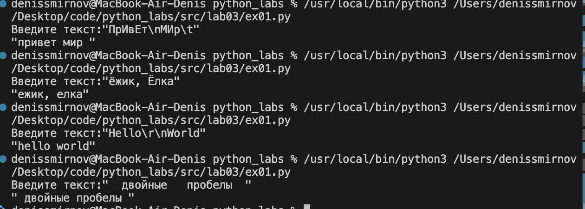
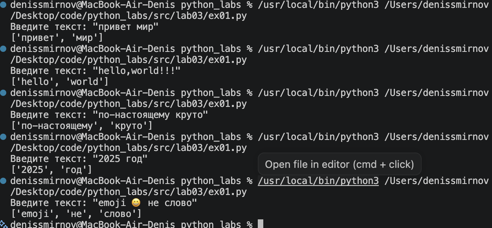
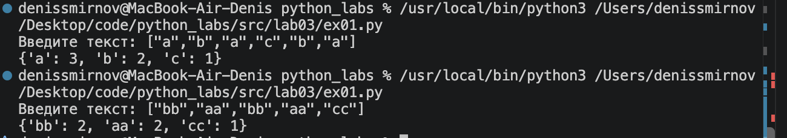
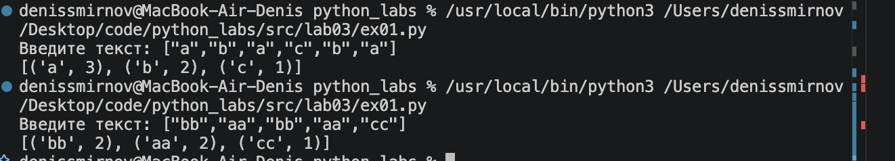
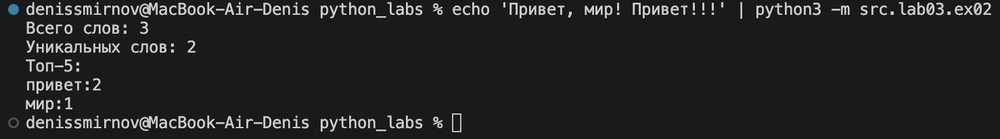
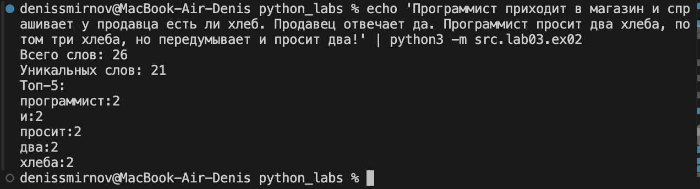

# ЛР3 — Тексты и частоты слов (словарь/множество)
## Задание А
### Функция normalize

Я привёл текст к нижнему регистру с помощью casefold(), заменил «ё» на «е» через replace(), а лишние пробелы убрал с помощью split() и " ".join().

```python
def normalize(text: str, *, casefold: bool = True, yo2e: bool = True) -> str:
    if casefold:
        text = text.casefold()
    if yo2e:
        text = text.replace("ё", "е").replace("Ё", "Е")

    text = text.replace("\\t", " ").replace("\\r", " ").replace("\\n", " ").split()

    return " ".join(text)
```


### Функуия tokeniza

Я выделил слова из текста с помощью re.findall() и регулярного выражения, которое учитывает слова через дефис.

```python 
def tokenize(text: str) -> list[str]:
    return re.findall(r"\w+(?:-\w+)*", text)
```


### Функция count_freq

Я подсчитал количество повторений каждого слова с помощью словаря: перебрал все слова и увеличивал счётчик для каждого повторения.

```python
def count_freq(tokens: list[str]) -> dict[str, int]:
    freq = {}
    for token in tokens:
        freq[token] = freq.get(token, 0) + 1
    return freq
```


### Функция top_n

Я отсортировал слова по частоте с помощью sorted() и выбрал первые пять самых часто встречающихся слов

```python
def top_n(freq: dict[str, int], n: int = 5) -> list[tuple[str, int]]:
    return sorted(freq.items(), key=lambda x: x[1], reverse=True)[:n]
```


## Задание 2

Скрипт читает весь входной текст через `sys.stdin.read()` до конца файла (EOF). Затем он нормализует текст, разбивает его на слова, подсчитывает частоту каждого слова и выводит общее количество слов, количество уникальных слов и пять самых частых слов.

```python
import sys
from src.lib.text import normalize, tokenize, count_freq, top_n

text = sys.stdin.read()


text = normalize(text)
tokens = tokenize(text)
freq = count_freq(tokens)

print(f"Всего слов: {len(tokens)}")
print(f"Уникальных слов: {len(freq)}")
print("Топ-5:")

for word, count in top_n(freq):
    print(f"{word}:{count}")
```




