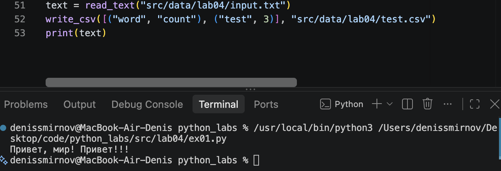
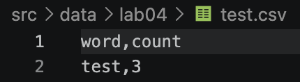

# Лабораторная работа №4 - Файлы: TXT/CSV и отчёты по текстовой статистике

## Задание А
### Функция read_text
```python
from pathlib import Path

def read_text(path: str | Path, encoding: str = "utf-8") -> str:
    """Читает всё содержимое файла и возвращает одной строкой.

    По умолчанию используется UTF-8. Для другой кодировки надо передать её явно,
    например: read_text(path, encoding="cp1251").
    """
    try:
        file_path = Path(path)
        return file_path.read_text(encoding=encoding)
    except FileNotFoundError:
        print(f"Файл {path} не найден")
        return ""
    except UnicodeDecodeError:
        print(f"Ошибка декодирования файла {path} с кодировкой {encoding}")
        return ""
```
Функция принимает путь к файлу и преобразует его в объект `Path`. Затем читает весь файл в указанной кодировке и возвращает его содержимое одной строкой. Если файл не найден или его не удаётся прочитать в выбранной кодировке, выводит сообщение об ошибке и возвращает пустую строку.

### Функция write_csv
```python
im
def ensure_parent_dir(path: str | Path) -> None:
    """Создать родительские директории для path, если их ещё нет."""
    Path(path).parent.mkdir(parents=True, exist_ok=True) 
    
def write_csv(rows: list[tuple | list], path: str | Path, header: tuple[str, ...] | None = None) -> None:
    """Записывает строки в CSV с разделителем-запятой.

    Если передан header, он записывается первой строкой.
    Все строки данных должны иметь одинаковую длину.
    """
    if header is not None:
        expected_length = len(header)
    else:
        expected_length = None
    for row in rows:
        if expected_length is None:
            expected_length = len(row)
        elif len(row) != expected_length:
            raise ValueError("Все строки CSV должны иметь одинаковую длину")

    ensure_parent_dir(path)
    with Path(path).open("w", newline="", encoding="utf-8") as file:
        writer = csv.writer(file, delimiter=",")

        if header is not None:
            writer.writerow(header)

        writer.writerows(rows)
```
`ensure_parent_dir` принимает путь к файлу и создаёт все нужные папки для него, если их ещё нет.

`write_csv` проверяет, что во всех строках одинаковое количество значений, затем создаёт папки для файла и записывает данные в CSV через запятую. Если передан заголовок, он записывается первой строкой.




## Задание B

```python 
def main():
    text = read_text("src/data/lab04/input.txt")

    if not text:
        return

    text = normalize(text)
    tokens = tokenize(text)
    freq = count_freq(tokens)

    top_words = top_n(freq)
    top_words = sorted(top_words, key=lambda item: (-item[1], item[0]))
    sorted_words = sorted(freq.items(), key=lambda item: (-item[1], item[0]))

    write_csv(sorted_words, "data/lab04/report.csv", header=("word", "count"))

    print(f"Всего слов: {len(tokens)}")
    print(f"Уникальных слов: {len(freq)}")
    print("Топ-5:")
    for i in top_words:
        print(f"{i[0]}: {i[1]}")


if __name__ == "__main__":
    main()
```
