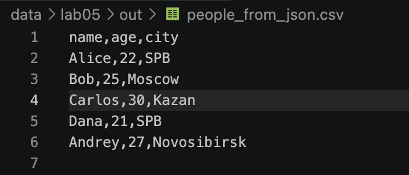
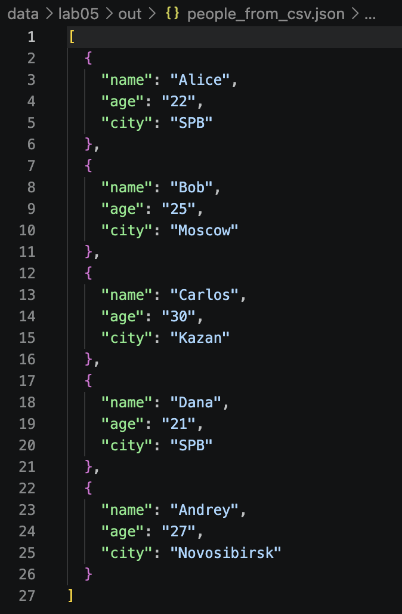
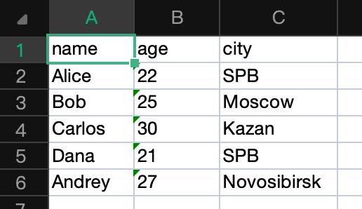

# Лабораторная работа № 5 — JSON, CSV и XLSX
## Структура проекта
```text
src/
└── lab05/
    ├── json_csv.py   # преобразование JSON ↔ CSV
    └── csv_xlsx.py   # преобразование CSV → XLSX

data/
└── lab05/
    ├── samples/      # входные примеры
    └── out/          # результаты преобразований
```

Все пути к файлам в примерах указываются относительно корня проекта. Перед запуском перейдите в корневой каталог репозитория. Для функций JSON ↔ CSV папка `data/lab05/out/` должна существовать; функция CSV → XLSX создаёт родительскую папку результата автоматически.
## Задание A — JSON ↔ CSV
### Функция json_to_csv
```python
def json_to_csv(json_path: str, csv_path: str) -> None:
    """
    Преобразует JSON-файл в CSV.
    Поддерживает список словарей [{...}, {...}], заполняет отсутствующие поля пустыми строками.
    Кодировка UTF-8. Порядок колонок — как в первом объекте или алфавитный (указать в README).
    """
    js = Path(json_path)
    cs = Path(csv_path)
    if js.suffix.lower() != ".json":
        raise ValueError("Ожидается файл .json")
    if cs.suffix.lower() != ".csv":
        raise ValueError("Ожидается файл .csv")
    if not js.exists():
        raise FileNotFoundError("Указанный файл JSON не существует")

    with js.open("r",encoding="utf-8") as f:
        try:
            data = json.load(f)
        except json.JSONDecodeError :
            raise ValueError("Пустой или некорректный JSON") 
        if not isinstance(data, list) or len(data) == 0:
            raise ValueError("Ожидается непустой список")

        for row in data:
            if not isinstance(row, dict):
                raise ValueError("Все элементы списка JSON должны быть словарями")
        ensure_parent_dir(cs)
        header = list(data[0].keys())
        for row in data[1:]:
            for key in row:
                if key not in header:
                    header.append(key)
    with cs.open("w", encoding="utf-8", newline="") as f:
        writer = csv.DictWriter(f, fieldnames=header, restval="")
        writer.writeheader()
        writer.writerows(data)  
```
Функция проверяет расширения файлов и наличие входного JSON, читает данные в кодировке UTF-8 и проверяет структуру списка. Заголовки CSV собираются по порядку первого появления ключей: сначала ключи первого словаря, затем новые ключи из следующих словарей. Если в записи отсутствует значение для одного из заголовков, соответствующая ячейка CSV остаётся пустой.

Пример вызова:
```python
json_to_csv(
    "data/lab05/samples/people.json",
    "data/lab05/out/people_from_json.csv",
)
```

### Функция csv_to_json
```python
def csv_to_json(csv_path: str, json_path: str) -> None:
    """
    Преобразует CSV в JSON (список словарей).
    Заголовок обязателен, значения сохраняются как строки.
    json.dump(..., ensure_ascii=False, indent=2)
    """
    js = Path(json_path)
    cs = Path(csv_path)
    if js.suffix.lower() != ".json":
        raise ValueError("Ожидается файл .json")
    if cs.suffix.lower() != ".csv":
        raise ValueError("Ожидается файл .csv")
    if not cs.exists():
        raise FileNotFoundError("Указанный файл CSV не существует")

    with cs.open("r",encoding="utf-8",newline="") as f:
        reader = csv.DictReader()
        if not reader.fieldnames:
            raise ValueError("В CSV нет заголовка")
        data = list(reader)
        if not data:
            raise ValueError("В CSV нет строк данных")
        
    ensure_parent_dir(js)
    with js.open("w",encoding="utf-8") as f:
        json.dump(data,f,ensure_ascii=False, indent = 2)
```
Преобразует CSV с заголовком в JSON — список словарей. Каждая строка CSV становится отдельным словарём, заголовки используются как ключи. Значения CSV сохраняются строками. JSON записывается в UTF-8 с `ensure_ascii=False` и отступом в два пробела.

Пример вызова:
```python
csv_to_json(
    "data/lab05/samples/people.csv",
    "data/lab05/out/people_from_csv.json",
)
```
#### Запуск из корня проекта:

```bash
/usr/local/bin/python3 -m src.lab05.ex01
```


Для записи результата родительская папка `data/lab05/out/` создаётся автоматически.

## Задание B
```python 
def ensure_parent_dir(path: Path) -> None:
    path.parent.mkdir(parents=True, exist_ok=True)

def csv_to_xlsx(csv_path: str, xlsx_path: str) -> None:
    csp = Path(csv_path)
    xlp = Path(xlsx_path)

    if csp.suffix.lower() != ".csv":
        raise ValueError("Ожидается файл .csv")
    if xlp.suffix.lower() != ".xlsx":
        raise ValueError("Ожидается файл .xlsx")
    if not csp.exists():
        raise FileNotFoundError("Указанный файл CSV не существует")

    with csp.open("r", encoding="utf-8", newline="") as f:
        rows = list(csv.reader(f))
    if not rows:
        raise ValueError("Файл CSV пустой")
    if not rows[0] or not any(cell.strip() for cell in rows[0]):
        raise ValueError("В CSV отсутствует заголовок")

    wb = Workbook()
    sheet = wb.active
    sheet.title = "Sheet1"

    for row in rows:
        sheet.append(row)

    for column in sheet.columns:
        max_length = 0

        for cell in column:
            if cell.value is not None:
                text = str(cell.value)
                if len(text) > max_length:
                    max_length = len(text)

        column_letter = column[0].column_letter

        if max_length < 8:
            max_length = 8

        sheet.column_dimensions[column_letter].width = max_length

    ensure_parent_dir(xlp)
    wb.save(xlp)
```
Функция csv_to_xlsx(csv_path, xlsx_path) переносит данные из CSV-файла в Excel-файл формата .xlsx.
1. Преобразует переданные пути в объекты Path.
2. Проверяет, что у исходного файла расширение .csv, у выходного — .xlsx, а исходный файл существует.
3. Читает CSV в кодировке UTF-8 и проверяет, что файл не пуст и содержит заголовок.
4. Создаёт книгу Excel с листом Sheet1 и записывает в него все строки CSV.
5. Подбирает ширину каждого столбца по самой длинной ячейке. Минимальная ширина — 8.
6. Создаёт родительскую папку для выходного файла, если её ещё нет, и сохраняет книгу.
Функция ensure_parent_dir(path) создаёт родительскую папку для указанного пути. Параметр parents=True позволяет создать недостающие папки по всей цепочке, а exist_ok=True — не выдавать ошибку, если папка уже существует.
Ошибки ValueError возникают при неверном расширении файла, пустом CSV или отсутствии заголовка. Если исходный CSV не найден, функция выдаёт FileNotFoundError.
### Пример вызова:
```python
    if __name__ == "__main__":
    csv_to_xlsx(
        "data/lab05/samples/people.csv",
        "data/lab05/out/people.xlsx"
    )
```
### Запуск из корня проекта:
```bash
/usr/local/bin/python3 -m src.lab05.ex02
```
### после открыть в xlxs:
```bash
open data/lab05/out/people.xlsx
```



### Входные файлы и результаты
Входные примеры хранятся в `data/lab05/samples/`:
- `people.json` — список объектов JSON;
- `people.csv` — те же данные в табличном виде;


Результаты сохраняются в `data/lab05/out/`:
- `people_from_json.csv` — результат JSON → CSV;
- `people_from_csv.json` — результат CSV → JSON;
- `people.xlsx` — результат CSV → XLSX.

## Обработка ошибок
Функции преобразования явно сообщают об ошибках:
- FileNotFoundError — входной файл не найден;
- ValueError — расширение входного или выходного файла не соответствует ожидаемому формату;
- ValueError — JSON пустой, некорректный или содержит неподдерживаемую структуру;
- ValueError — элементы JSON-списка не являются словарями;
- ValueError — в CSV отсутствует заголовок или строки данных.
