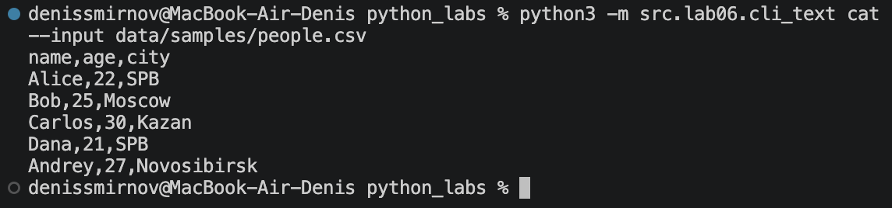
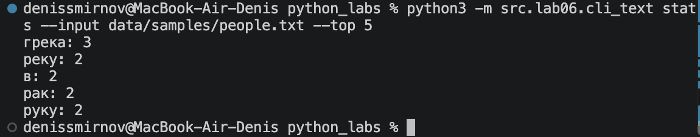
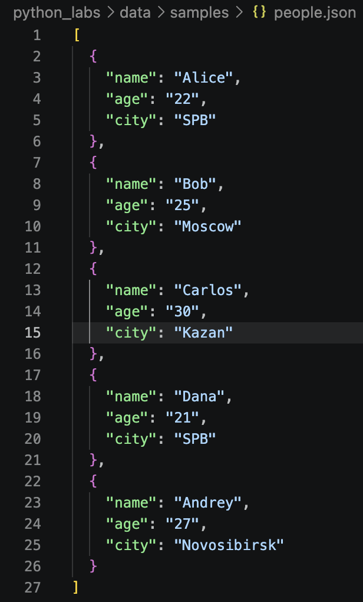
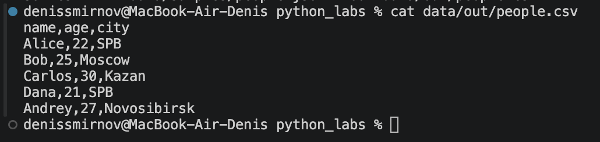
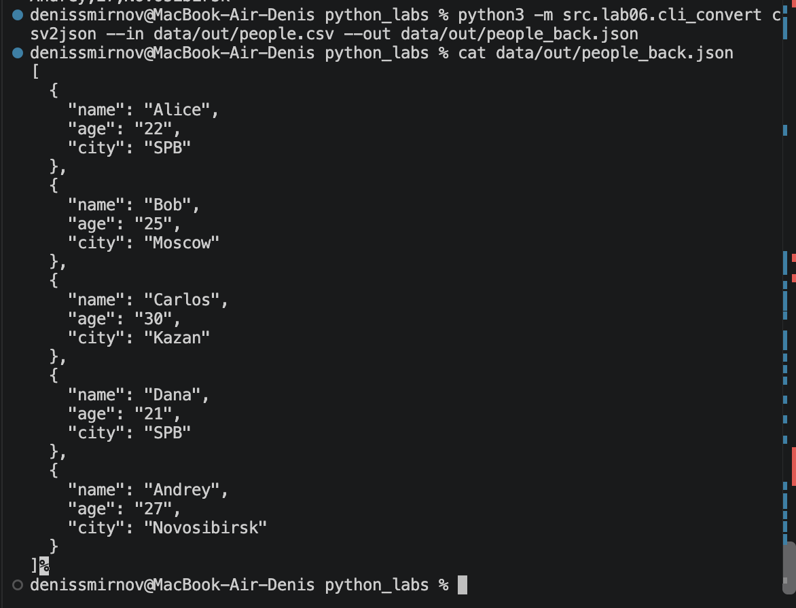
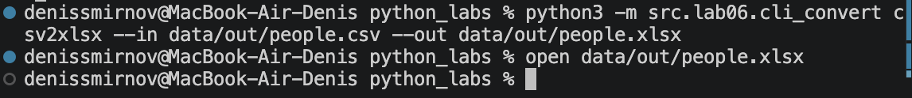
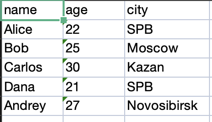

# Лабораторная работа № 6 — CLI-утилиты с argparse

## Структура проекта

```text
src/
└── lab06/
    ├── __init__.py
    ├── cli_text.py       # вывод файлов и анализ текста
    └── cli_convert.py    # запуск конвертеров из ЛР5

data/
├── samples/              # входные файлы
└── out/                  # результаты конвертации

images/
└── lab06/                # скриншоты работы программ
```

Все команды выполняются из корня проекта, где находится папка `src`. Для запуска используется `python3 -m` и путь к модулю через точки.

## Задание A — Текстовые утилиты

Модуль `src/lab06/cli_text.py` поддерживает две подкоманды: `cat` и `stats`. Аргументы командной строки обрабатываются с помощью `argparse`.

### Создание парсера и подкоманд

```python
parser = argparse.ArgumentParser(description="Утилиты для работы с текстом")
subparsers = parser.add_subparsers(dest="command", required=True)

cat_parser = subparsers.add_parser("cat", help="Вывести содержимое файла")
cat_parser.add_argument("--input", required=True, help="Путь к входному файлу")
cat_parser.add_argument("-n", action="store_true", help="Нумеровать строки")

stats_parser = subparsers.add_parser("stats", help="Показать частоты слов")
stats_parser.add_argument("--input", required=True, help="Путь к текстовому файлу")
stats_parser.add_argument("--top", type=int, default=5, help="Количество самых частых слов")

args = parser.parse_args()
```

`ArgumentParser` описывает интерфейс программы. Метод `add_subparsers()` позволяет выбрать подкоманду, название которой сохраняется в `args.command`.

Параметр `--input` обязателен для обеих подкоманд. Флаг `-n` сохраняет `True`, если пользователь указал его при запуске. Параметр `--top` принимает целое число и по умолчанию равен 5.

### Подкоманда cat

```python
if args.command == "cat":
    try:
        with open(args.input, encoding="utf-8") as file:
            for number, line in enumerate(file, start=1):
                if args.n:
                    print(f"{number}: {line}", end="")
                else:
                    print(line, end="")

    except FileNotFoundError:
        parser.error(f"файл не найден: {args.input}")
```

Подкоманда открывает файл в кодировке UTF-8 и выводит его построчно. `enumerate()` добавляет номера строк, начиная с единицы. Если указан флаг `-n`, номер выводится перед строкой.

Параметр `end=""` предотвращает добавление лишнего перевода строки, поскольку строки файла обычно уже содержат символ `\n`.

### Запуск с нумерацией

```bash
python3 -m src.lab06.cli_text cat --input data/samples/people.csv -n
```
python_labs/images/lab06/1.1.png

### Запуск без нумерации

```bash
python3 -m src.lab06.cli_text cat --input data/samples/people.csv
```


### Подкоманда stats

Для анализа текста используются функции из предыдущих лабораторных работ:

```python
from src.lib.text import normalize, tokenize, count_freq, top_n
```

Обработка подкоманды:

```python
elif args.command == "stats":
    if args.top <= 0:
        parser.error("--top должен быть больше нуля")

    try:
        with open(args.input, encoding="utf-8") as file:
            text = file.read()

    except FileNotFoundError:
        parser.error(f"файл не найден: {args.input}")

    normalized = normalize(text)
    tokens = tokenize(normalized)
    freq = count_freq(tokens)
    result = top_n(freq, args.top)

    for word, count in result:
        print(f"{word}: {count}")
```

Программа читает текст целиком и последовательно вызывает четыре функции:

1. `normalize()` приводит текст к единому регистру и заменяет `ё` на `е`.
2. `tokenize()` выделяет слова.
3. `count_freq()` подсчитывает количество вхождений каждого слова.
4. `top_n()` выбирает наиболее частые слова.

### Входной файл

Содержимое `data/samples/people.txt`:

```text
Ехал Грека через реку,
Видит Грека — в реке рак.
Сунул Грека руку в реку,
Рак за руку Греку — цап!
```

### Запуск

```bash
python3 -m src.lab06.cli_text stats --input data/samples/people.txt --top 5
```


## Задание B — Конвертеры данных

Модуль `src/lab06/cli_convert.py` предоставляет три подкоманды:

- `json_to_csv` — преобразование JSON в CSV;
- `csv_to_json` — преобразование CSV в JSON;
- `csv_to_xlsx` — преобразование CSV в XLSX.

Используются функции из ЛР5:

```python
from src.lab05.ex01 import json_to_csv, csv_to_json
from src.lab05.ex02 import csv_to_xlsx
```

### Аргументы подкоманд

```python
parser = argparse.ArgumentParser(description="Конвертеры JSON, CSV и XLSX")
subparsers = parser.add_subparsers(dest="command", required=True)

json_parser = subparsers.add_parser("json2csv", help="Преобразовать JSON в CSV")
csv_parser = subparsers.add_parser("csv2json", help="Преобразовать CSV в JSON")
xlsx_parser = subparsers.add_parser("csv2xlsx", help="Преобразовать CSV в XLSX")

for command_parser in (json_parser, csv_parser, xlsx_parser):
    command_parser.add_argument("--in", dest="input", required=True, help="Путь к входному файлу")
    command_parser.add_argument("--out", dest="output", required=True, help="Путь к выходному файлу")

args = parser.parse_args()
```

Каждая подкоманда принимает два обязательных параметра: `--in` и `--out`.

С помощью `dest` задаются имена полей результата: `args.input` и `args.output`. Цикл добавляет одинаковые параметры всем трём подкомандам.

### Проверка путей и вызов конвертера

```python
input_path = Path(args.input)
output_path = Path(args.output)

try:
    if not input_path.is_file():
        raise FileNotFoundError(f"входной файл не найден: {input_path}")

    if input_path.resolve() == output_path.resolve():
        parser.error("входной и выходной файлы должны различаться")

    output_path.parent.mkdir(parents=True, exist_ok=True)

    if args.command == "json2csv":
        json_to_csv(args.input, args.output)

    elif args.command == "csv2json":
        csv_to_json(args.input, args.output)

    elif args.command == "csv2xlsx":
        csv_to_xlsx(args.input, args.output)

except (OSError, ValueError) as error:
    parser.error(str(error))
```

Перед преобразованием проверяется наличие входного файла и различие путей. Родительская папка результата создаётся автоматически.

После проверки вызывается функция, соответствующая выбранной подкоманде. Алгоритмы конвертации используются из ЛР5 без дублирования.

### JSON → CSV

Входной файл `data/samples/people.json`:

Запуск:

```bash
python3 -m src.lab06.cli_convert json2csv --in data/samples/people.json --out data/out/people.csv
```

Просмотр результата:

```bash
cat data/out/people.csv
```


### CSV → JSON

```bash
python3 -m src.lab06.cli_convert csv2json --in data/out/people.csv --out data/out/people_back.json
```

Просмотр результата:

```bash
cat data/out/people_back.json
```



### CSV → XLSX

```bash
python3 -m src.lab06.cli_convert csv2xlsx --in data/out/people.csv --out data/out/people.xlsx
```

Открытие результата в macOS:

```bash
open data/out/people.xlsx
```



## Справка по программе

Общая справка показывает доступные подкоманды:

```bash
python3 -m src.lab06.cli_text --help
python3 -m src.lab06.cli_convert --help
```

Справка для отдельных подкоманд:

```bash
python3 -m src.lab06.cli_text cat --help
python3 -m src.lab06.cli_text stats --help
python3 -m src.lab06.cli_convert json2csv --help
python3 -m src.lab06.cli_convert csv2json --help
python3 -m src.lab06.cli_convert csv2xlsx --help
```
## Обработка ошибок

### Отсутствующий файл

```bash
python3 -m src.lab06.cli_text cat --input data/samples/missing.txt
```

Программа сообщает, что файл не найден, и завершает работу без traceback.

### Недопустимое значение --top

```bash
python3 -m src.lab06.cli_text stats --input data/samples/people.txt --top 0
```

Сообщение:

```text
--top должен быть больше нуля
```

Если вместо числа передать текст, ошибка определяется при разборе аргументов:

```bash
python3 -m src.lab06.cli_text stats --input data/samples/people.txt --top abc
```

### Пропущенный обязательный параметр

```bash
python3 -m src.lab06.cli_convert json2csv --in data/samples/people.json
```

`argparse` сообщает о необходимости передать `--out`.

### Одинаковые пути файлов

```bash
python3 -m src.lab06.cli_convert json2csv --in data/samples/people.json --out data/samples/people.json
```

Сообщение:

```text
входной и выходной файлы должны различаться
```

## Результаты работы

Созданы два модуля с пятью подкомандами. Реализованы разбор параметров, автоматическая справка и проверка ошибочного ввода. Функции анализа текста и конвертации из предыдущих лабораторных работ подключены к интерфейсу командной строки.

Результаты преобразований сохраняются в `data/out/`, скриншоты — в `images/lab06/`.
````