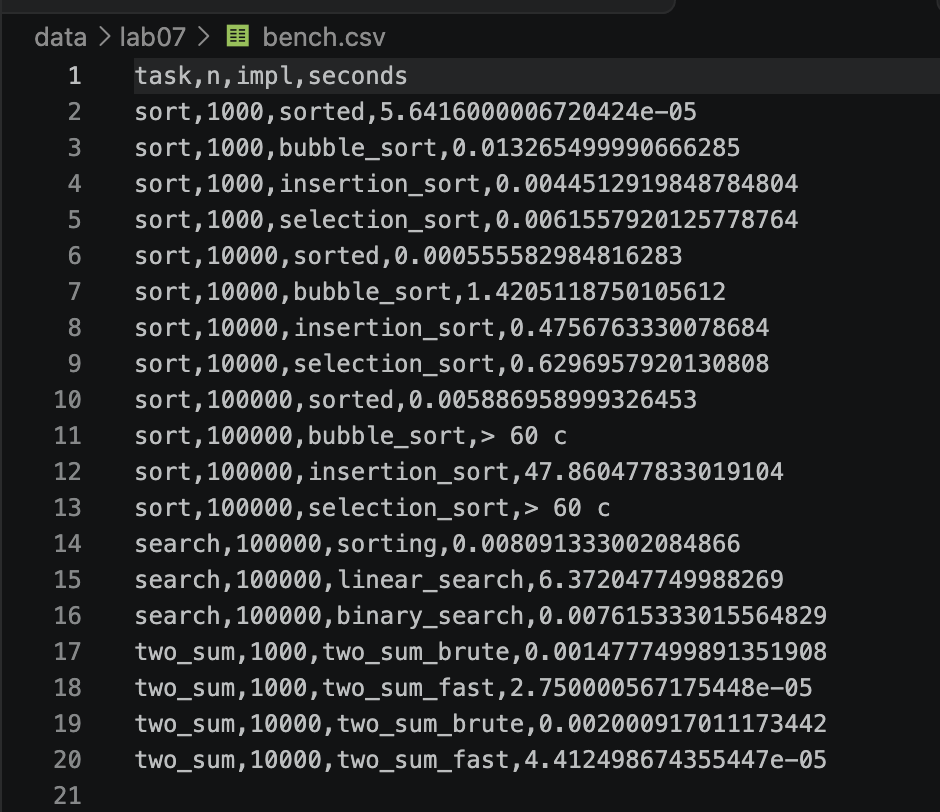

````markdown
# Лабораторная работа № 7 — Поиск, сортировка и измерение времени

## Структура проекта

```text
src/
├── lab04/
│   └── io_txt_csv.py       # функция write_csv
└── lab07/
    ├── search.py          # поиск и Two Sum
    ├── sorting.py         # сортировки
    ├── check.py           # автоматические проверки
    ├── bench.py           # измерение времени
    └── README.md

data/
└── lab07/
    └── bench.csv          # результаты измерений

images/
└── lab07/
    ├── bench_sort_1k.png
    └── itog_v_csv.png
```

Все команды выполняются из корня проекта, где находится папка `src`.

## Задание A — Поиск

В модуле `src/lab07/search.py` реализованы четыре функции.

### Линейный поиск

Функция `linear_search(nums, x)` последовательно просматривает список слева направо и возвращает индекс первого вхождения `x`. Если элемента нет, возвращает `-1`.

Предварительная сортировка не требуется. В худшем случае необходимо просмотреть весь список, поэтому сложность составляет O(n).

### Бинарный поиск

Функция `binary_search(sorted_nums, x)` работает на списке, отсортированном по возрастанию.

Переменные `lo` и `hi` задают левую и правую границы. Пока `lo <= hi`, вычисляется индекс середины:

```python
mid = (lo + hi) // 2
```

Если средний элемент равен `x`, функция возвращает его индекс. Если `x` больше среднего элемента, левая граница перемещается на `mid + 1`. Если меньше — правая граница перемещается на `mid - 1`.

Каждый шаг уменьшает область поиска примерно вдвое. Сложность алгоритма — O(log n).

Если элемент отсутствует, возвращается `-1`. При повторах допустим индекс любого вхождения. На неотсортированном списке правильность результата не гарантируется.

### Two Sum — перебор пар

Функция `two_sum_brute(nums, target)` ищет два разных индекса `(i, j)`, для которых:

```python
i < j
nums[i] + nums[j] == target
```

Для поиска используются два вложенных цикла. Внутренний начинается с `i + 1`, чтобы не использовать один элемент дважды и не проверять одну пару в обратном порядке.

Если пара найдена, возвращаются её индексы. Если пары нет — `None`. В худшем случае сложность составляет O(n²).

### Two Sum — словарь

Функция `two_sum_fast(nums, target)` выполняет один проход по списку и сохраняет в словаре пары «число → индекс».

Для текущего элемента вычисляется дополнение:

```python
x = target - nums[i]
```

Если дополнение уже есть в словаре, возвращается пара индексов. Иначе текущий элемент добавляется в словарь.

Проверка выполняется до добавления текущего элемента, поэтому один индекс не используется дважды. Ожидаемая сложность — O(n), дополнительная память — O(n).

## Задание B — Сортировки

В модуле `src/lab07/sorting.py` реализованы три сортировки по возрастанию.

Каждая функция начинает работу с копирования списка:

```python
nums2 = nums.copy()
```

Поэтому исходный список не изменяется. Готовые `sorted`, `.sort()`, `min` и `max` внутри алгоритмов не используются.

### Пузырьковая сортировка

Функция `bubble_sort(nums)` сравнивает соседние элементы и меняет их местами, если левый больше правого.

После каждого прохода наибольший элемент оставшейся части оказывается справа. Следующий проход рассматривает на один элемент меньше.

Для раннего выхода используется флаг `Flag`. Перед каждым проходом он получает значение `True`, при обмене — `False`. Если обменов не было, список уже отсортирован и выполняется `break`.

Худшая сложность — O(n²), лучший случай с ранним выходом — O(n).

### Сортировка вставками

Функция `insertion_sort(nums)` постепенно расширяет отсортированную часть слева.

Текущий элемент сохраняется в переменную `current`. Большие элементы сдвигаются вправо, после чего `current` записывается на освободившееся место.

Худшая сложность — O(n²). На уже отсортированном списке — O(n).

### Сортировка выбором

Функция `selection_sort(nums)` на каждом проходе находит индекс минимального элемента оставшейся части списка.

Затем найденный минимум меняется местами с элементом на текущей позиции.

Количество сравнений остаётся квадратичным даже на отсортированных данных. Сложность — O(n²).

Все три функции обрабатывают пустой список, один элемент и повторяющиеся значения. Из-за создания копии дополнительная память составляет O(n).

## Задание C — Проверка против эталона

Модуль `src/lab07/check.py` автоматически проверяет написанные алгоритмы.

### Проверка сортировок

Функция `check_sorting(fn, trials=100)` принимает сортировку и проверяет её на 100 случайных списках.

Длина списка выбирается от 0 до 50, значения — от −100 до 100. Возможны отрицательные числа и повторы.

Проверяются два условия:

```python
assert nums == nums2
assert sorted(nums2) == nums_fn
```

Первое проверяет сохранность исходного списка, второе — правильность результата.

### Проверка поиска

Функция `check_search()` проверяет оба поиска на 100 случайных списках.

Результат линейного поиска сравнивается с `list.index`. Если `list.index` вызывает `ValueError`, ожидается результат `-1`.

Бинарный поиск вызывается на отсортированном списке. Если число присутствует, проверяются допустимость индекса и равенство найденного элемента искомому числу. Точное совпадение с индексом первого вхождения не требуется.

Дополнительно проверяются:

- первый элемент списка;
- последний элемент;
- число, которого в списке нет.

### Проверка Two Sum

Функция `check_two_sum(trials=100)` проверяет оба решения на 100 случайных случаях.

Оба алгоритма должны либо вернуть `None`, либо найти допустимую пару. Для найденных пар проверяются условия:

```python
assert 0 <= i < j < len(nums)
assert nums[i] + nums[j] == target
```

Сами пары могут различаться, поскольку у задачи бывает несколько правильных ответов.

### Запуск и результат

Для воспроизводимости случайных данных используется:

```python
random.seed(42)
```

Запуск:

```bash
python3 -m src.lab07.check
```

Результат:

```text
OK
```

Выполнены 300 случайных прогонов сортировок, 100 случаев проверки поиска и 100 случаев Two Sum — всего 500 случайных сценариев. Дополнительно выполняются три отдельные проверки бинарного поиска.

Один сценарий может содержать несколько `assert`, поэтому число сценариев не равно числу утверждений.

При проверочном запуске расхождений не обнаружено. Во время разработки были исправлены границы бинарного поиска, начало перебора пар, границы проходов пузырька и выбор индекса минимума.

## Задание D — Бенчмарк

Модуль `src/lab07/bench.py` измеряет время через `timeit`:

```python
seconds = timeit.timeit(lambda: fn(nums), number=1)
```

`number=1` означает один запуск измеряемой функции. Для поиска один замер включает обработку всех 10 000 запросов.

Данные генерируются до начала измерения. В пределах каждого сравнения алгоритмы получают одинаковые входные данные. Перед запуском установлено `random.seed(42)`.

Измеряются:

- `sorted` и три собственные сортировки на 1 000 и 10 000 элементах;
- линейный и бинарный поиск: 10 000 запросов к списку из 100 000 элементов;
- два решения Two Sum на 1 000 и 10 000 элементах.

Для бинарного поиска время предварительной сортировки записывается отдельной строкой `sorting`.

Для Two Sum значение `target` равно сумме двух последних элементов. Это гарантирует существование пары, но другая подходящая пара может встретиться раньше.

### Запуск

```bash
python3 -m src.lab07.bench
```

Результаты выводятся таблицей в терминал и сохраняются через `write_csv` из ЛР4 в:

```text
data/lab07/bench.csv
```

Колонки:

```text
task,n,impl,seconds
```

### Таблица результатов

Данные из сохранённого `bench.csv`. Время указано в секундах.



### Результаты в CSV


## Выводы

При увеличении размера списка с 1 000 до 10 000 пузырьковая сортировка замедлилась примерно в 90 раз, вставки — в 108 раз, выбор — в 104 раза. Это соответствует квадратичному характеру роста: увеличение размера в 10 раз даёт примерно в 100 раз больше работы. У пузырька без раннего выхода число сравнений равно n(n − 1) / 2. Встроенный `sorted` замедлился примерно в 12,4 раза. Для O(n log n) теоретическое отношение объёмов работы на этих размерах составляет около 13,3. Реальное время зависит от данных и условий выполнения. Ранний выход пузырька особенно полезен на уже отсортированных данных; сортировка вставками также эффективно обрабатывает почти отсортированные списки.

Бинарный поиск требует отсортированного списка: только тогда сравнение с серединой позволяет безопасно отбросить половину элементов. Линейный поиск выполнил 10 000 запросов за 6,2124 с. Сортировка и бинарный поиск вместе заняли 0,008078625 + 0,007036458 ≈ 0,015115 с, то есть примерно в 411 раз меньше. Сортировка выполняется один раз перед всей серией запросов. По средним временам этого замера подготовка окупается примерно после 14 запросов к неизменному списку. Это приблизительная оценка для данного эксперимента. Для одного запроса к неотсортированному списку обычно выгоднее линейный поиск.

В Two Sum реализация со словарём оказалась быстрее перебора на обоих размерах. При этом на 10 000 элементах обе функции завершились быстрее, чем на 1 000: время зависит от положения первой подходящей пары. Сумма двух последних элементов гарантирует наличие ответа, но не гарантирует позднее завершение. Поэтому эти одиночные замеры не показывают непосредственно квадратичный и линейный рост. Худшая сложность перебора остаётся O(n²), ожидаемая сложность решения со словарём — O(n).

